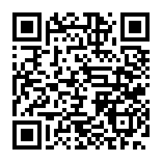
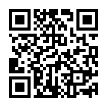
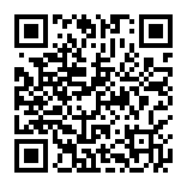
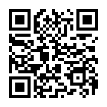

# ❤️ Support AutoClipper

AutoClipper is free and always will be. If it saves you hours of editing or earns you money, a tip keeps it going.

**How:** hover over an address and click the 📋 copy button on the right (or scan the QR code with your wallet app).
Send only the coin listed, on the network listed. Other coins or networks sent to these addresses are lost.

| Bitcoin (BTC) | USDT (Tron · TRC-20) | Solana (SOL) | Ethereum (ETH) |
|:---:|:---:|:---:|:---:|
|  |  |  |  |

### Bitcoin (BTC) · network: Bitcoin
```text
bc1p4h0mpf66yf3tf64auhz5hu0l22jagvfzsja6zz4qy63xcevgx6gs6qrf9h
```

### USDT · network: Tron (TRC-20)
```text
TQbzWvdvLoruNr4drYZXZNCQbrcK6CvV99
```

### Solana (SOL) · network: Solana
```text
DZybEbVkahQq4L2zHx2Vs4jag9Has7TVs7i9BgY59CW5
```

### Ethereum (ETH) · network: Ethereum mainnet
```text
0xA086baC43bD8fE83c8A97043eEca959DfD426AA6
```

Can't donate? A ⭐ on the repo or sharing it with another clipper helps just as much.
