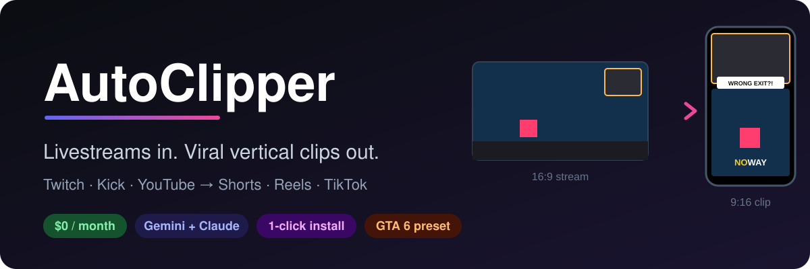
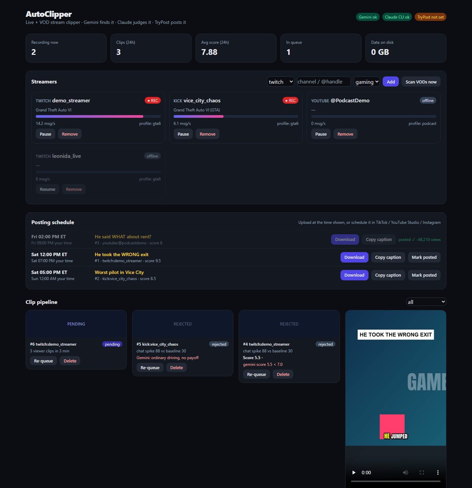
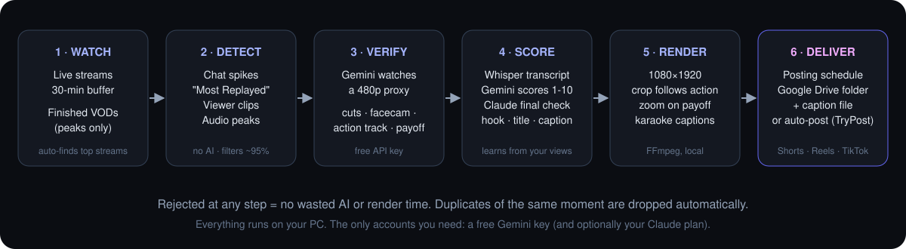
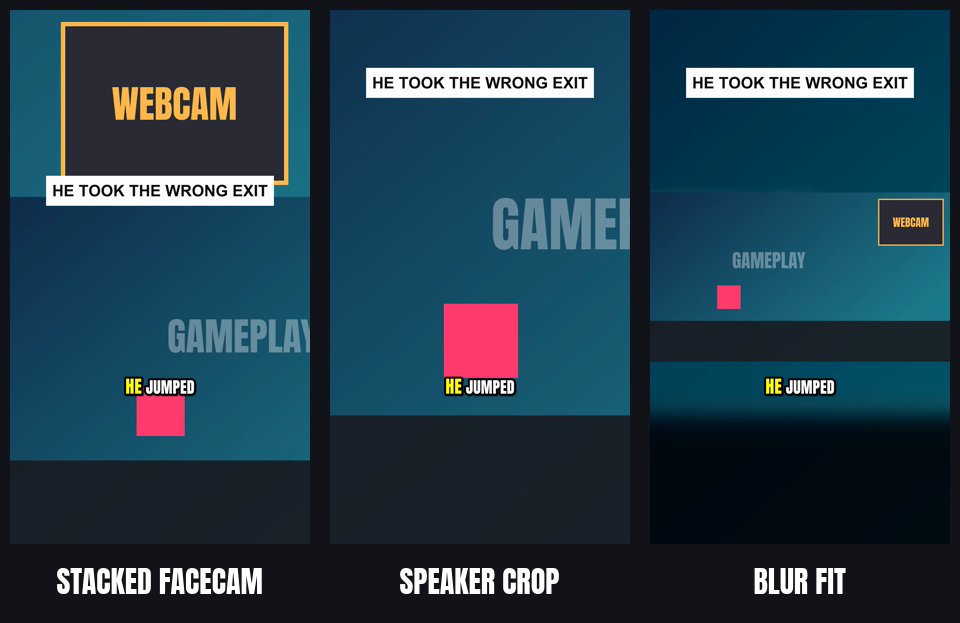

<p align="center">
  
</p>

<p align="center">
  <b>Self-hosted, $0/month stream clipper.</b> It watches Twitch, Kick and YouTube streams, finds the moments
  chat went crazy for, and turns them into ready-to-post Shorts, Reels and TikToks: captions, hook and all.<br>
  Comes with a ready-made <b>GTA 6</b> preset.
</p>

<p align="center">
  <a href="#-install-in-one-line">Install</a> ·
  <a href="#-how-it-works">How it works</a> ·
  <a href="#-make-money-with-it-the-right-way">Make money</a> ·
  <a href="#%EF%B8%8F-settings">Settings</a> ·
  <a href="#-faq">FAQ</a>
</p>

---

<table>
<tr>
<td width="290" valign="top"></td>
<td valign="top">

### What you get

- 🎯 **Finds the moments**: chat spikes, YouTube's "Most Replayed" peaks, viewer-clip clusters and audio peaks. No AI is spent on dead air.
- 🧠 **Two AI judges, both free**: Gemini watches the clip; Claude (your existing plan, optional) gives the final word.
- 🎬 **Edits like a human**: 9:16 crop that **follows the action**, webcam stacked on top, a **zoom on the punchline**, word-by-word karaoke captions and a 3.5 s hook banner.
- 📅 **Posting schedule**: 3 peak-time slots a day, with every clip + caption file copied to your **Google Drive**.
- 📈 **Learns from your views**: paste the link after posting, and it tracks views and scores future clips like your best ones.
- 🔎 **Finds streams for you**: picks up the biggest live streams in your niche every hour.
- 🧹 **No duplicates**, no full-VOD downloads, cleans up after itself.

<sub>The demo above uses a synthetic test scene, not real stream footage.</sub>

</td>
</tr>
</table>

## 🚀 Install in one line

**Windows**: open **PowerShell** (Start → type `PowerShell`) and paste:

```powershell
irm https://raw.githubusercontent.com/mohanadbarakattt/autoclipper/main/install.ps1 | iex
```

**macOS / Linux**: open Terminal and paste:

```bash
curl -fsSL https://raw.githubusercontent.com/mohanadbarakattt/autoclipper/main/install.sh | bash
```

That installs Python and FFmpeg if you don't have them, downloads AutoClipper to `~/AutoClipper`, adds a
**Desktop shortcut** (Windows) and starts it. Run the same line again any time to update; your keys, streamers
and clips are kept.

### First start (one time, about 10 minutes)

| Step | What happens |
|---|---|
| 1 | It installs its own packages and the speech-to-text model. Let it run. |
| 2 | A browser tab opens on **Google AI Studio** → click **Create API key** → paste it into the window. Free, no card. |
| 3 | *(Optional)* If you have [Claude Code](https://claude.com/claude-code) and a Claude plan, it offers to log you in. Without it, Gemini does everything. |
| 4 | Answer **Y** to *start with Windows*. Your dashboard opens at **http://localhost:8090**. |

Then add a streamer in the dashboard (or pick the `gta6` preset, which finds GTA 6 streams by itself) and wait
for clips to appear.

<details>
<summary><b>Manual install</b> (git clone)</summary>

```bash
git clone https://github.com/mohanadbarakattt/autoclipper && cd autoclipper
# Windows: double-click start.bat        macOS / Linux: ./start.sh
```
Requires Python 3.10+ and FFmpeg on your PATH.
</details>

## 🖥️ The dashboard



- **Streamers**: who is live, what's being recorded, chat speed. Add, pause or remove channels.
- **Posting schedule**: each finished clip gets a slot (your local time is shown too). **Download**, **Copy caption**, then **Mark posted** and paste the post link so it can track views.
- **Clip pipeline**: every candidate and why it passed or got rejected.

## 🔍 How it works



It picks the layout for each clip automatically:



## 💸 What it costs

| Piece | Cost |
|---|---|
| Gemini | **$0**: free [AI Studio key](https://aistudio.google.com/apikey), no billing. Google may use free-tier inputs to improve its models. |
| Claude | **$0 extra, optional**: runs Claude Code on the plan you already have (no API key). It only checks the clips that already passed, so it uses little of your limit. |
| Whisper, FFmpeg, yt-dlp, streamlink | **$0**, open source, run on your PC |
| Hardware | Any PC that can stay on. CPU-only is fine. Keep ~20 GB free. |

## 💰 Make money with it, the right way

Reposting someone's stream without permission gets accounts struck. These ways pay and keep you safe:

1. **Paid clipping campaigns.** Streamers and brands pay clippers per view on marketplaces such as
   [Content Rewards](https://contentrewards.com). The typical rate is **about $1 per 1,000 views** (range $0.05–$3).
   Join a campaign, set up a profile with its rules, post your clips, submit the links.
   *Example math: 3 clips/day × 30k views ≈ 2.7M views/month ≈ $2,700 at $1 per 1,000. Treat that as an
   upside figure, not a promise.*
2. **Clipping as a service.** Small streamers (50–1,000 viewers) rarely have an editor. Send 3 free clips
   from their last stream, then offer a monthly package.
3. **Your own streams or podcast.** Clip yourself, no permission needed.

**Always:** credit the streamer (captions do this automatically), follow each campaign's rules, and start in
draft mode until you trust the output. You are responsible for what your accounts post.

## ⚙️ Settings

Each streamer uses a **profile** in `config/profiles/` (`gta6`, `gaming`, `podcast`, `arabic`, `default`).
Copy one to start a new niche; any key you leave out uses the default in `clipper/config.py`.

| Key | What it does |
|---|---|
| `game_or_topic_filter` | Only clip when the stream's category matches (`A\|B\|C`). Empty = everything. |
| `auto_discover` | Find the top live streams for this niche every hour (`twitch_game`, `kick_category`, `youtube_query`, `top_n`, `min_viewers`). |
| `layout_mode` | `auto`, `stacked_facecam`, `speaker_crop`, `blur_fit` |
| `clip_duration` | Min/max seconds (shorter = better completion rate) |
| `min_viral_score` | Score gate (1–10). Lower it if almost nothing passes. |
| `posting_times`, `posting_timezone` | Daily posting slots (default 12:00 / 17:00 / 21:00 New York) |
| `whisper_model` | `large-v3-turbo` (default, accurate) or `small` (faster on slow PCs) |
| `language` | `en`, `ar`, … or leave empty to auto-detect |
| `follow_action`, `payoff_zoom` | Moving crop and punchline zoom on/off |

Useful `.env` options: `EXPORT_DIR` (Google Drive folder), `MAX_LIVE_RECORDINGS`, `SCORER` (`auto` / `gemini` / `claude`).

**Optional free platform keys** (better signals): [Twitch app](https://dev.twitch.tv/console/apps) for game
filtering, viewer-clip peaks and Twitch auto-discovery; [Kick app](https://kick.com/settings/developer) for
Kick auto-discovery.

**Hands-off auto-posting** to YouTube / Instagram / TikTok via self-hosted [TryPost](https://github.com/trypostit/trypost):
see [docs/AUTOPOST.md](docs/AUTOPOST.md) and [docs/SOCIAL_SETUP.md](docs/SOCIAL_SETUP.md).

## ❓ FAQ

<details><summary><b>Nothing is passing the score gate</b></summary>

That's normal for the first hours: most moments in a stream aren't viral. Check the rejection reasons in the
Clip pipeline. If good moments are rejected, lower `min_viral_score` by 0.5. Bigger streams with busy chats
produce far more usable moments.
</details>

<details><summary><b>Do I need a Claude subscription?</b></summary>

No. Gemini handles everything on its own. Claude only adds a stricter final check if you have it.
</details>

<details><summary><b>Will it slow my PC down?</b></summary>

Each live recording uses a little CPU and ~1 GB of rolling disk space; rendering a clip uses the CPU for a
minute or two. `MAX_LIVE_RECORDINGS` (default 4) caps how many streams record at once.
</details>

<details><summary><b>Where are my clips?</b></summary>

`data/ready_clips/` and, if `EXPORT_DIR` is set, in your Google Drive folder, sorted by posting day with a
caption `.txt` next to each video.
</details>

<details><summary><b>Gemini says "busy" / 503</b></summary>

The free tier gets overloaded at peak times. AutoClipper automatically falls back to the lighter Flash-Lite
model and retries, so you don't need to do anything.
</details>

## ❤️ Support the project

AutoClipper is free and open source. If it makes you money, consider supporting it:

<!-- TODO before going public: replace with real links / addresses -->
- **Sponsor:** _Polar link coming soon_
- **Crypto:** _addresses coming soon_
- **Hosted version** (no PC needed): _waitlist coming soon_

## 🧩 Project layout

```
clipper/
  ingest/      live.py · ringbuffer.py · spikes.py · platforms.py · vod.py · discover.py
  processor/   ai.py (Gemini + Claude) · render.py · learn.py · publish.py · export.py · pipeline.py
  dashboard/   app.py (FastAPI) · static/index.html
config/        streamers.json · profiles/*.json
data/          state/clipper.db · ring_buffers · candidates · ready_clips
```

MIT licensed. TryPost is AGPL-3.0 and runs as its own container. Not affiliated with Rockstar Games, Twitch,
Kick, YouTube, Google or Anthropic.
